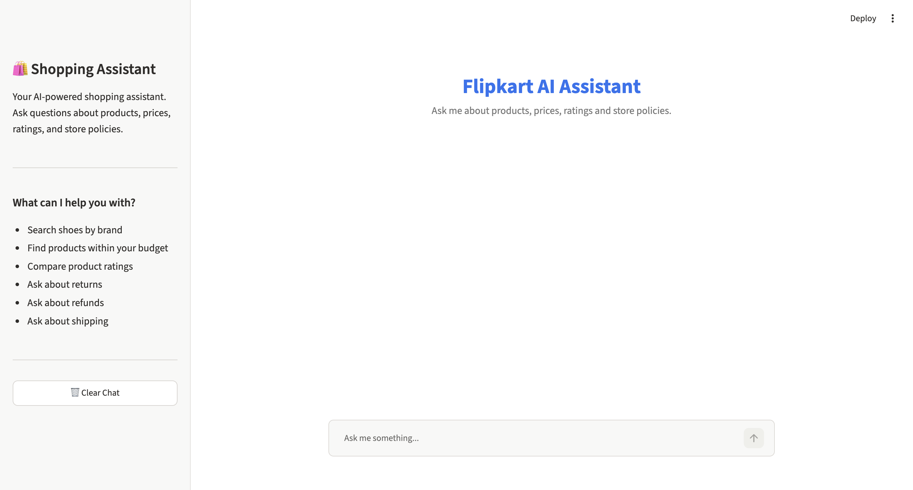
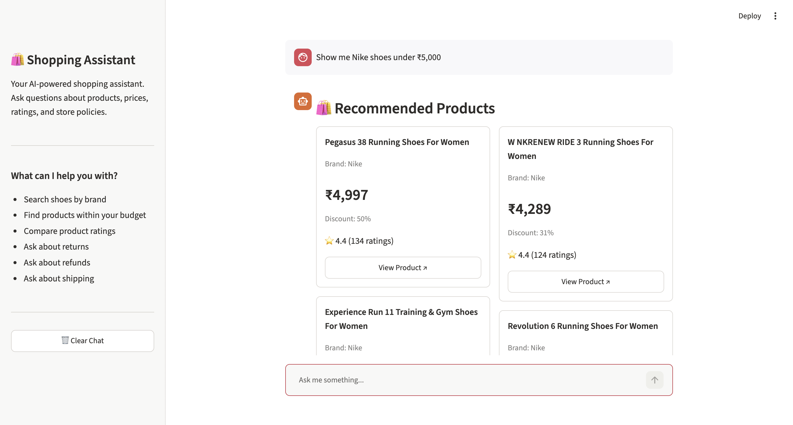
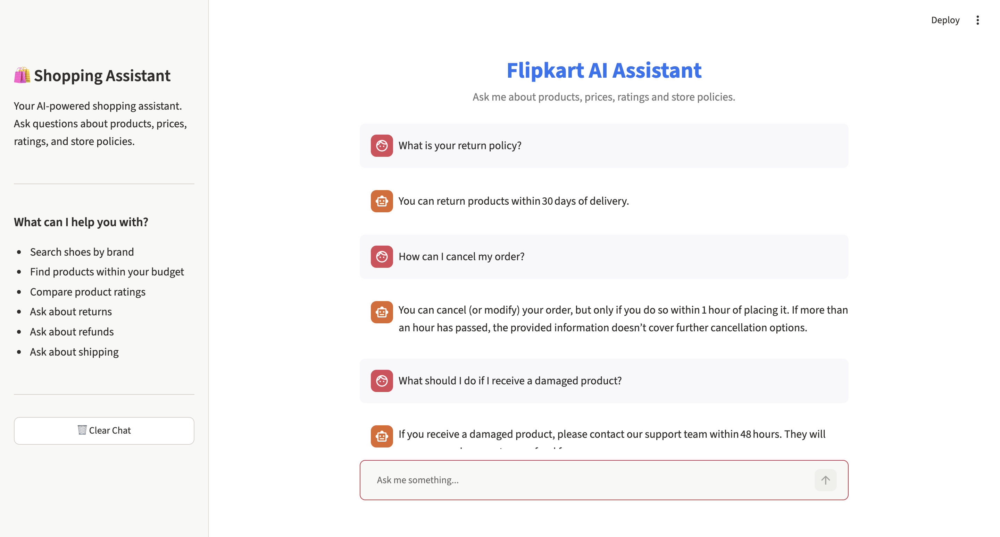
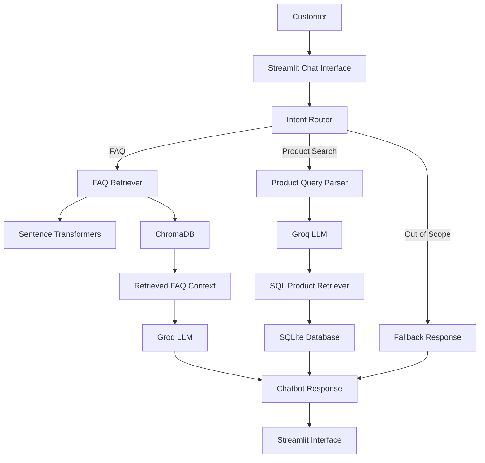

# 🛍️ GenAI E-commerce Shopping Assistant

An AI-powered e-commerce shopping assistant built using **Generative AI, Retrieval-Augmented Generation (RAG), semantic search, and SQL-based product retrieval**.

This project demonstrates how an intelligent shopping assistant can understand customer questions, retrieve relevant store information, search product catalogues using natural language, and present personalized product recommendations through an interactive Streamlit interface.

> **Note:** This is an independent Flipkart-inspired demonstration project. It is not affiliated with or integrated into Flipkart.

## 🚀 Features

### 1. Intelligent FAQ Assistant
- Uses Retrieval-Augmented Generation (RAG) to answer store-related questions.
- Retrieves relevant FAQ information using semantic search.
- Uses Sentence Transformers for text embeddings.
- Stores and searches FAQ embeddings using ChromaDB.
- Generates contextual responses using GPT-OSS 120B through Groq.

### 2. Natural Language Product Search
- Understands customer requests in natural language.
- Extracts product filters such as brand, maximum price, minimum rating, and result limit.
- Converts extracted filters into structured SQL queries.
- Retrieves matching products from SQLite.
- Uses Bayesian average ranking to account for differences in customer review counts.

### 3. Intelligent Intent Routing
Classifies incoming customer questions into three categories:

- **FAQ:** Store policies, returns, refunds, cancellations, and shipping.
- **Product:** Product searches based on brand, budget, and ratings.
- **Out of Scope:** Questions unrelated to the available store information or product catalogue.

### 4. Interactive Streamlit Interface
- Conversational chat interface.
- Chat history management.
- Clear Chat functionality.
- Product recommendation cards.
- Two-column product layout.
- Product prices, brands, discounts, and ratings.
- Clickable product links.


## 📸 Application Screenshots

### Chatbot Interface



### Product Recommendations



### FAQ Assistant




## 🏗️ System Architecture

The application follows a modular architecture combining semantic retrieval, structured database queries, and LLM-powered natural language understanding.

### Application Workflow

1. Customer enters a question through the Streamlit interface.
2. The Intent Router identifies the type of request.
3. FAQ questions are processed through the RAG pipeline.
4. Product questions are processed through the natural-language query parser.
5. Extracted product filters are used to construct parameterized SQL queries.
6. SQLite retrieves and ranks matching products.
7. The chatbot returns the response to the Streamlit interface.

### Architecture Diagram



## 🛠️ Technologies Used

| Technology | Purpose |
|---|---|
| Python | Core programming language |
| Streamlit | Interactive frontend |
| Groq API | LLM inference |
| GPT-OSS 120B | Natural language understanding and response generation |
| Sentence Transformers | Text embeddings |
| ChromaDB | Vector database for FAQ retrieval |
| SQLite | Structured product database |
| SQL | Product filtering and retrieval |
| Pandas | Data cleaning and preprocessing |
| Pydantic | Data validation dependency |
| python-dotenv | Environment variable management |

## 📂 Project Structure

```text
flipkart-genai-chatbot/
│
├── data/
│   ├── faq_data.csv
│   ├── ecommerce_data_final.csv
│   │
│   └── processed/
│       ├── faq_cleaned.csv
│       └── products_cleaned.csv
│
├── app.py
├── chatbot.py
├── llm_service.py
├── intent_router.py
├── faq_retriever.py
├── product_search.py
├── product_retriever.py
├── product_query_parser.py
│
├── clean_data.py
├── create_database.py
├── build_faq_database.py
│
├── requirements.txt
├── .env
├── .gitignore
└── README.md
```

Additional testing scripts are included in the repository.

Generated databases and virtual environment files are excluded from version control.

## ⚙️ Installation and Setup

### Prerequisites

- Python 3.10 or later (Python 3.13.3 was used during development).
- Git.
- A Groq API key.

### 1. Clone the Repository

```bash
git clone YOUR_GITHUB_REPOSITORY_URL

cd flipkart-genai-chatbot
```

Replace `YOUR_GITHUB_REPOSITORY_URL` with your repository URL.

### 2. Create a Virtual Environment

```bash
python -m venv venv
```

Activate it on macOS or Linux:

```bash
source venv/bin/activate
```

On Windows:

```bash
venv\Scripts\activate
```

### 3. Install Dependencies

```bash
pip install -r requirements.txt
```

### 4. Configure Environment Variables

Create a `.env` file in the project root.

Add your Groq API key:

```env
GROQ_API_KEY=your_groq_api_key_here
```

Never commit your actual API key to GitHub.

### 5. Prepare the Datasets

Run the data cleaning script:

```bash
python clean_data.py
```

This generates cleaned FAQ and product datasets inside `data/processed/`.

### 6. Create the SQLite Database

```bash
python create_database.py
```

This creates the structured product database containing the cleaned product records.

### 7. Build the FAQ Vector Database

```bash
python build_faq_database.py
```

This generates embeddings for the FAQ questions and stores them in a persistent ChromaDB collection.

The embedding model used is:

```text
sentence-transformers/all-MiniLM-L6-v2
```

### 8. Run the Application

```bash
python -m streamlit run app.py
```

Open the local Streamlit URL displayed in your terminal, usually:

```text
http://localhost:8501
```

## 💬 Example Questions

### FAQ Questions

- What is your return policy?
- How can I cancel my order?
- What should I do if I receive a damaged product?
- How can I track my order?

### Product Search Questions

- Show me Nike shoes under ₹5,000.
- Find Puma shoes below ₹3,000.
- Show me shoes with a rating above 4.5.
- Find the top 10 shoes under ₹2,000.

### Out-of-Scope Questions

- Show me the latest iPhone.
- Who won the cricket match?
- What is the weather today?

The assistant provides a fallback response when a question is outside its supported scope.

## 📊 Dataset Information

The project uses two CSV datasets.

### FAQ Dataset

- 10 FAQ records.
- Contains customer questions and corresponding answers.
- Used to build the semantic FAQ retrieval system.

### Product Dataset

- 903 product records.
- Contains product titles, brands, prices, discounts, ratings, review counts, and product links.
- Used to build the SQLite product database.

The available product catalogue consists of women's shoes.

## 🧠 Key Technical Concepts Demonstrated

- Retrieval-Augmented Generation (RAG).
- Semantic search and vector embeddings.
- Natural language processing.
- LLM-powered intent classification.
- Structured query extraction.
- SQL-based information retrieval.
- Bayesian average ranking.
- Modular Python application development.
- Interactive AI application development.

## ⚠️ Limitations

- The product catalogue is limited to the supplied women's shoe dataset.
- Product prices and ratings are dataset values, not live marketplace information.
- Product links may become unavailable over time.
- FAQ answers are based on the supplied sample FAQ dataset and should not be interpreted as verified current Flipkart policies.
- The application does not support real-time inventory, order tracking, payments, or actual Flipkart account integration.
- LLM responses depend on Groq API availability and applicable usage limits.

## 🔮 Future Improvements

- Add product images.
- Expand the catalogue to additional product categories.
- Introduce product comparison functionality.
- Add conversation memory.
- Improve retrieval evaluation and response quality.
- Add automated testing and application logging.
- Deploy the application to a cloud platform.

## 👨‍💻 Author

**Rahul Yadav Nethula**

M.S. Data Science

GitHub: [github.com/rahulyadav1999](https://github.com/rahulyadav1999)

LinkedIn: [linkedin.com/in/rahul-yadav-nethula](https://linkedin.com/in/rahul-yadav-nethula)

---

⭐ If you find this project interesting, feel free to explore the repository and its implementation.